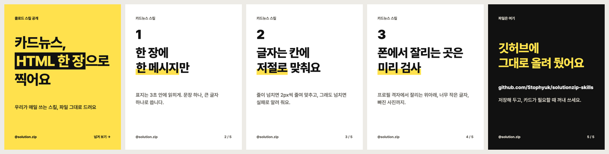

# solutionzip Claude skills

[한국어](README.md) · English

When you work with Claude Code, you end up explaining the same things every session: how to shoot card news, what to check before a deploy, what never to do on a server. These are the ways [solutionzip](https://solutionzip.kr) (문제해결집) actually works, split into fifteen skills.



> The skill files are written in Korean, and the copy rules, checklists and templates are made for Korean text. Claude reads them as they are, so you can still ask in English.

## Skills

**Make**

| Skill | What it does |
|---|---|
| [`card-news`](skills/card-news) | Lays out card news in one HTML file, shoots each card as a PNG, then checks for what breaks on a phone |
| [`html-shorts`](skills/html-shorts) | Shoots HTML scenes frame by frame into a 1080×1920 vertical video and a cover image |
| [`app-intro-kit`](skills/app-intro-kit) | Reads your project to fill in the entry sheet for solutionzip's "Vibe Coding World Cup" (concept, whose problem, how it is solved), checks the character limits, then shoots one screen and finds the logo. If you want more, it bakes an intro deck (one self-contained 16:9 HTML file, a PDF, a 30–60 second video) |

**Check**

| Skill | What it does |
|---|---|
| [`vibe-app-checkup`](skills/vibe-app-checkup) | Sweeps an app built with AI coding tools for exposed keys, open database rules and payment checks, and writes a risk report with a grade |
| [`anti-slop`](skills/anti-slop) | Measures the "AI look" of a screen and rewrites stacked effects and stock phrases as "do this instead" |
| [`page-shots`](skills/page-shots) | Shoots every page at desktop and phone width, and catches pages that scroll sideways, 404s and broken images |
| [`ko-copy-lint`](skills/ko-copy-lint) | Finds exaggeration (최고 · 100% · 보장), clichés and banned words in Korean copy and suggests sentences to use instead |
| [`ai-before-after`](skills/ai-before-after) | Runs the same samples before and after a prompt or model change and compares them in a table |
| [`secret-guard`](skills/secret-guard) | Blocks API keys and passwords pasted into the prompt before they are sent, and masks secrets already left in your prompt history and session logs |

**Ways of working**

| Skill | What it does |
|---|---|
| [`solo-dev-kit`](skills/solo-dev-kit) | Sets up a session-start summary, a pre-push check and a work log (`/record`) in your project |
| [`kakao-notify`](skills/kakao-notify) | Messages your KakaoTalk "chat with myself" when a long task ends or Claude is waiting for permission (macOS) |
| [`one-box-server`](skills/one-box-server) | Runs several apps and their databases on one server, with deploys, backups, restore drills and rollbacks |
| [`new-project`](skills/new-project) | Starts a new project with a folder, git and a CLAUDE.md skeleton first, then has you continue in a fresh session opened in that folder |
| [`harness-tune`](skills/harness-tune) | Call it once a month: it tallies your session logs, reports what to tune in CLAUDE.md, memory, hooks and plugins, changes only what you approve, and keeps a before/after log in one file |
| [`fresh-review`](skills/fresh-review) | Hands outgoing documents to a review agent that has not seen the conversation, to check numbers and claims against the sources |

## Install

You need Node 18 or later. The skills that take screenshots (card-news, html-shorts, app-intro-kit, page-shots, anti-slop) need Chrome and Playwright, the ones that make video (html-shorts, app-intro-kit) also need ffmpeg, and secret-guard and harness-tune need Python 3.

```sh
git clone https://github.com/Stophyuk/solutionzip-skills.git
cd solutionzip-skills
npm i                      # playwright and subset-font (font trimming)

# copy only the skills you want into Claude Code
mkdir -p ~/.claude/skills
cp -r skills/card-news skills/page-shots ~/.claude/skills/
```

Then just ask: "make card news about …", "make an intro deck for my app", "check whether this app is safe to make public", "capture every page", "add KakaoTalk notifications". Claude first shows what it will do, one line per step, and goes ahead once you agree.

## What the skills hold to

- No unverified numbers, superlatives or guarantees, and the same goes for the reports and copy the skills write.
- Keys and passwords never appear on screen. The checkup skill shows only the first few characters of a key it finds.
- Anything that changes a production server or database is explained first and done only after you answer.
- Taking part is never made a condition, as in "follow us to get it" (Meta's spam policy).
- Realistic AI-made images and voices get the AI label switched on when they are posted.

Checklists: [card news](skills/card-news/checklist.md) · [shorts](skills/html-shorts/checklist.md) · [app intro](skills/app-intro-kit/checklist.md) · [app checkup](skills/vibe-app-checkup/checklist.md) · [AI look](skills/anti-slop/checklist.md) · [copy](skills/ko-copy-lint/rules.md)

## Stuck on a project?

Run the skills over it, and if it needs more hands, write to us at [solutionzip.kr](https://solutionzip.kr) (the site is in Korean). We pick up stalled projects and finish them.

## License

MIT. Commercial use is fine.
