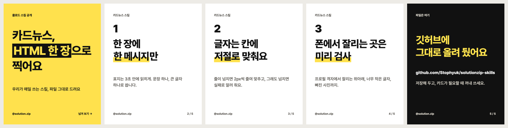

# 문제해결집 클로드 스킬

한국어 · [English](README.en.md)

클로드 코드로 일하다 보면 같은 설명을 세션마다 다시 하게 됩니다. 카드뉴스를 찍는 법, 배포 전에 볼 것, 서버에서 하면 안 되는 일 같은 것들입니다. [문제해결집](https://solutionzip.kr)이 실제로 쓰는 방식을 스킬 열 개로 떼어 냈습니다.



## 스킬

**만들기**

| 스킬 | 하는 일 |
|---|---|
| [`card-news`](skills/card-news) | HTML 한 장으로 카드뉴스를 짜고 카드마다 PNG로 찍은 뒤, 폰에서 깨지는 곳을 검사 |
| [`html-shorts`](skills/html-shorts) | HTML 장면을 프레임마다 찍어 1080×1920 세로 영상과 표지로 |

**점검**

| 스킬 | 하는 일 |
|---|---|
| [`vibe-app-checkup`](skills/vibe-app-checkup) | AI 코딩 도구로 만든 앱의 키 노출 · 열린 DB 규칙 · 결제 검증을 훑어 위험 보고서와 등급을 낸다 |
| [`anti-slop`](skills/anti-slop) | 화면의 'AI 티'를 재고, 겹친 효과와 상투 문구를 "대신 이렇게"로 고친다 |
| [`page-shots`](skills/page-shots) | 모든 페이지를 PC · 폰 폭으로 찍고, 가로로 밀리는 페이지 · 404 · 깨진 그림을 잡는다 |
| [`ko-copy-lint`](skills/ko-copy-lint) | 한국어 문구의 과장(최고 · 100% · 보장) · 상투어 · 금지어를 찾아 고칠 문장을 제안한다 |
| [`ai-before-after`](skills/ai-before-after) | 프롬프트 · 모델을 바꾸기 전과 후를 같은 표본으로 돌려 표로 견준다 |

**일하는 틀**

| 스킬 | 하는 일 |
|---|---|
| [`solo-dev-kit`](skills/solo-dev-kit) | 세션 시작 요약 · 푸시 전 검사 · 작업 기록(`/record`)을 프로젝트에 깐다 |
| [`kakao-notify`](skills/kakao-notify) | 긴 작업이 끝나거나 허락을 기다릴 때 카톡 '나와의 채팅'으로 알린다(맥) |
| [`one-box-server`](skills/one-box-server) | 서버 한 대에 앱 여러 개와 DB를 올리고 배포 · 백업 · 복구 연습 · 되돌리기를 굴린다 |

## 설치

필요한 것: Node 18 이상. 화면을 찍는 스킬(card-news · html-shorts · page-shots · anti-slop)은 크롬과 playwright, 숏폼은 ffmpeg.

```sh
git clone https://github.com/Stophyuk/solutionzip-skills.git
cd solutionzip-skills
npm i                      # playwright 하나

# 쓰고 싶은 스킬만 클로드 코드에 넣기
mkdir -p ~/.claude/skills
cp -r skills/card-news skills/page-shots ~/.claude/skills/
```

넣은 뒤에는 말로 부르면 됩니다. "카드뉴스 만들어줘: 주제", "이 앱 공개해도 되는지 점검해줘", "전 페이지 캡처해줘", "카톡 알림 달아줘". 클로드가 무엇을 할지 먼저 한 줄씩 보여 주고, 좋다고 하면 진행합니다.

## 지키는 것

- 확인 안 된 숫자 · 최상급 · 보장 표현은 쓰지 않습니다. 스킬이 내는 보고서와 문구도 같습니다.
- 키 · 비밀번호는 화면에 찍지 않습니다. 점검 스킬도 찾은 키를 앞 몇 글자만 보여 줍니다.
- 운영 서버 · 운영 DB를 바꾸는 일은 무엇이 바뀌는지 먼저 말하고, 답을 받은 뒤에 합니다.
- "팔로우하면 드려요"처럼 참여를 조건으로 걸지 않습니다(메타 스팸 정책).
- AI로 만든 사실적인 이미지 · 목소리는 올릴 때 AI 표시를 켭니다.

점검표: [카드뉴스](skills/card-news/checklist.md) · [숏폼](skills/html-shorts/checklist.md) · [앱 점검](skills/vibe-app-checkup/checklist.md) · [AI 티](skills/anti-slop/checklist.md) · [카피](skills/ko-copy-lint/rules.md)

## 만들다 막힌 프로젝트가 있다면

스킬로 점검해 보고 손이 더 필요하면 [solutionzip.kr](https://solutionzip.kr)에 적어 주세요. 멈춘 프로젝트를 이어서 끝내는 일을 합니다.

## 라이선스

MIT. 상업적으로 써도 됩니다.
